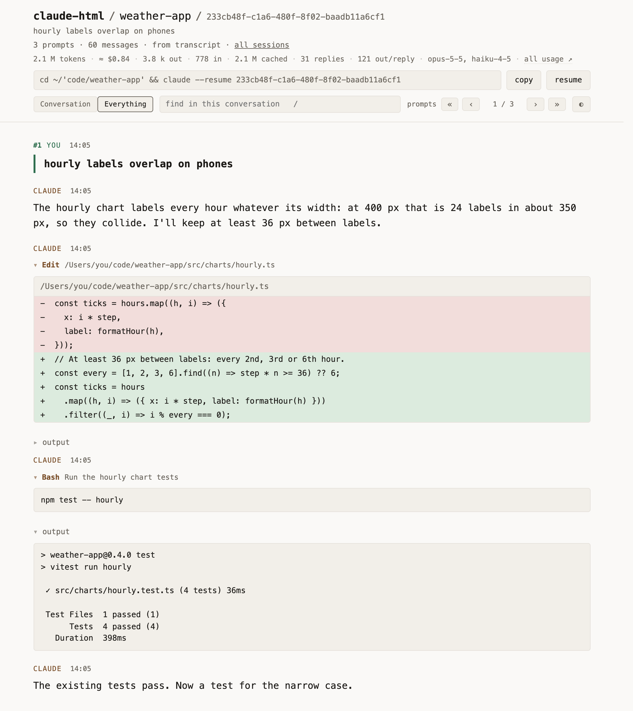
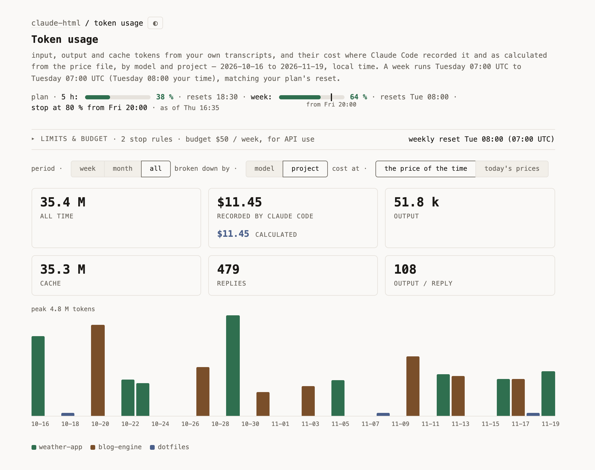
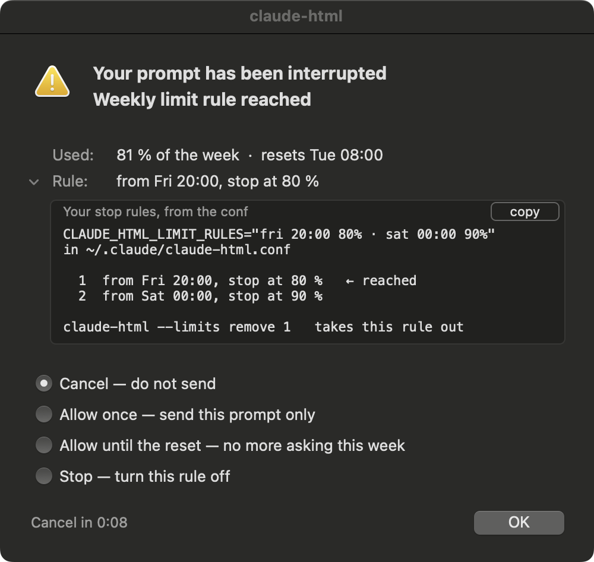

# claude-html

[](https://github.com/pier0074/claude-html/actions/workflows/test.yml)


[](LICENSE)
[](https://github.com/pier0074/claude-html/stargazers)

Every Claude Code conversation you have, kept forever and readable in your
browser: searchable, diffed, costed, and resumable with one click. One-line
install, nothing to add, and it builds itself while you work.

<picture>
  <source media="(prefers-color-scheme: dark)" srcset="docs/img/index-dark.png">
  
</picture>

<picture>
  <source media="(prefers-color-scheme: dark)" srcset="docs/img/session-dark.png">
  
</picture>

<picture>
  <source media="(prefers-color-scheme: dark)" srcset="docs/img/usage-dark.png">
  
</picture>

<picture>
  <source media="(prefers-color-scheme: dark)" srcset="docs/img/usage-project-dark.png">
  
</picture>

<p>
  
  
</p>

## Why

Claude Code deletes transcripts after 30 days, and raw JSONL is unreadable.
This keeps everything as plain HTML on your own disk: no server, no database,
no dependencies, and not one byte of your conversations leaves your machine.

- **Automatic** — hooks save after every reply, when a session ends and before
  compaction, so a page is never more than one reply behind. Saves read only
  what was appended: a few seconds at most, even for a 160 MB session
- **Search everything** — full text across all conversations, straight to the message
- **Readable** — numbered prompts, labelled tool calls, real diffs; one click hides the machinery
- **Fast, even at 16 MB** — a conversation of fifteen thousand messages opens in half a second
- **Resumable** — a **resume** button reopens the conversation in a terminal, in
  the right folder; **copy** gives you the `cd … && claude --resume …` line
- **Permanent** — archives live beside your projects, past the 30-day cleanup,
  with thinking and token counts
- **Token dashboard** — by week, month or all time, by model or by project;
  weeks can start when your plan's allowance resets
- **Cost** — what Claude Code recorded, and beside it, never mixed in, what the
  tokens cost at the list price of the time, from a dated price file with its
  sources and a price history
- **Private** — static files; the pages make no requests and nothing about your
  conversations leaves your machine. Once a day the tool asks GitHub for the list
  of releases (`claude-html --update off` stops it). Light and dark, with a ◐ toggle
- **Secrets masked** — tokens, keys and passwords become `***` in the pages, the
  search and the archives; Claude Code's own transcript is left as it is
- **Guard** — a prompt or a command holding a secret is stopped before Claude
  sees it, and you choose: cancel, allow once, safe, or stop
- **Plan limits** — your 5-hour and weekly usage on Claude Code's status line
  and the pages; your own stop rules ("from Fri 20:00, stop at 80 %") ask
  before a new prompt, and an API budget warns at 80 and 95 %

## Install

```bash
git clone https://github.com/pier0074/claude-html ~/claude-html
cd ~/claude-html && ./install.sh
```

For a given release, add `--branch v3.5.1` to the clone;
[CHANGELOG.md](CHANGELOG.md) says what each one brought.

Nothing else to install. macOS uses its own `osascript`; Linux uses `node`,
which a machine running Claude Code already has. A Mac that happens to have
node uses it too, being faster — node is never installed for you.

**Where you clone it is the configuration.** The pages are written in the
clone folder (`index.html` appears right there), and its *parent* is the
projects root: every session started anywhere under it is archived. Clone
into `~/Sites/claude-html` and everything under `~/Sites` is covered. Or say
so: `./install.sh --out DIR --root DIR`.

The installer only adds: its hooks go beside the ones you have, and a second
run keeps `~/.claude/claude-html.conf` as you left it. Every setting, and
every way to set it up, is in [docs/SETUP.md](docs/SETUP.md).

## Update

```bash
claude-html --update            # go to the newest release
claude-html --update 3.0.0      # go to that release
claude-html --update list       # every release available
claude-html --update status     # what is installed, what is newest
```

Once a day the tool asks GitHub whether a newer release exists and says so
on the index; `claude-html --update off` stops that. From a release before
3.1.0: `git checkout main && git pull && ./install.sh` in the clone. Details in
[docs/SETUP.md](docs/SETUP.md#updating).

## Use

Day to day: nothing — open `index.html` and read. The command is for the exceptions:

```bash
claude-html              # rebuild now and open the index
claude-html --force      # rebuild every page from scratch
claude-html --doctor     # what this machine is and which of its tools does each job
bash tests/run-all.sh    # every test suite, macOS and Linux
```

## Uninstall

```bash
cd ~/claude-html && ./install.sh --uninstall
```

Removes the command, the helper app or link handler, and its own hooks; keeps
the pages, the archives and your conf. Details, including how to erase every
trace, are in [docs/DETAILS.md](docs/DETAILS.md#uninstall).

## More

**[docs/SETUP.md](docs/SETUP.md)** — every setting, command and hook, with defaults.

**[docs/DETAILS.md](docs/DETAILS.md)** — how saving works and why no message
can be lost, the engine choice, search, long conversations, the dashboard,
deleting to the Trash, sub-agents, claude.ai exports, configuration, and what
each Linux desktop gets.

## License

MIT. Not affiliated with or endorsed by Anthropic; Claude is their trademark.
