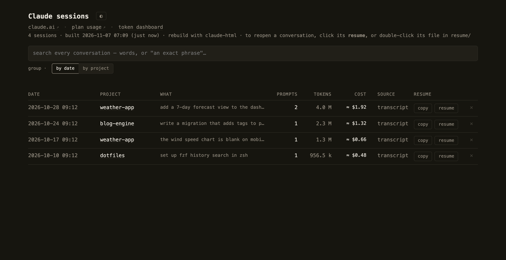
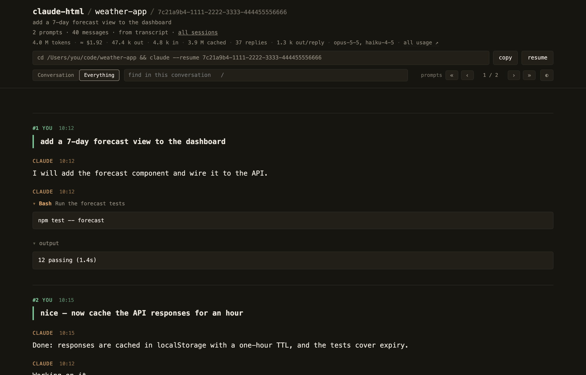
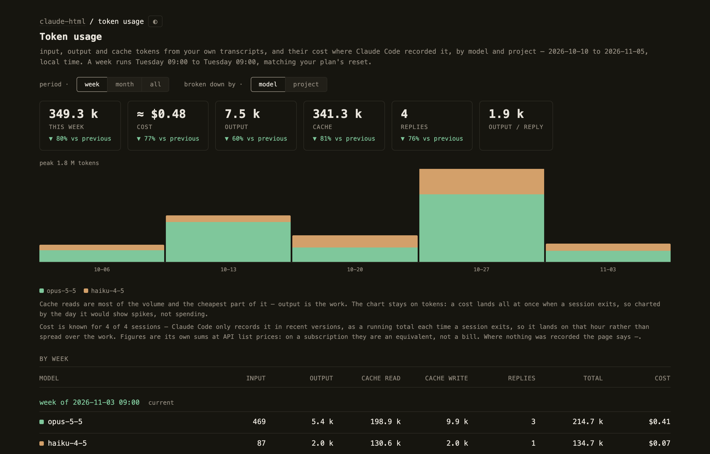
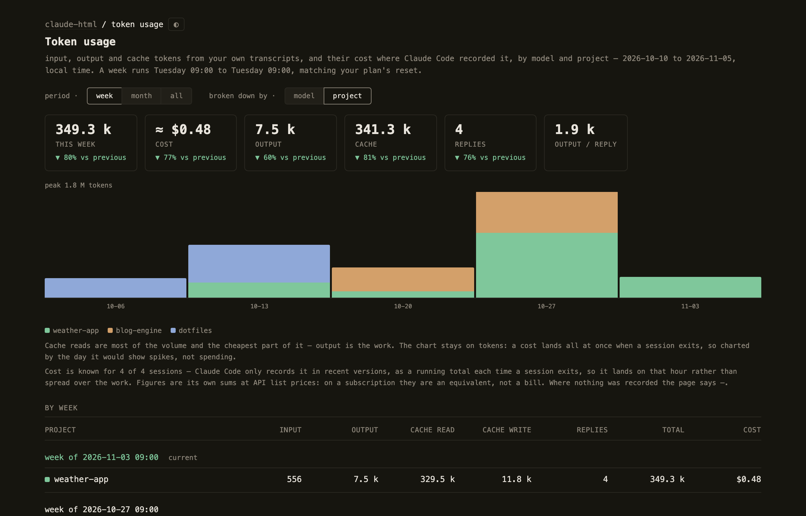

# claude-html

[](https://github.com/pier0074/claude-html/actions/workflows/test.yml)


[](LICENSE)
[](https://github.com/pier0074/claude-html/stargazers)

Every Claude Code conversation you have, kept forever and readable in your
browser: searchable, diffed, costed, and resumable with one click. One-line
install, nothing to add, and it builds itself while you work.









## Why

Claude Code deletes transcripts after 30 days, and raw JSONL is unreadable.
This keeps everything as plain HTML on your own disk: no server, no database,
no dependencies, and not one byte leaves your machine.

- **Automatic** — hooks save after every reply, when a session ends and before
  compaction, so a page is never more than one reply behind. Saves read only
  what was appended: a few seconds at most, even for a 160 MB session
- **Search everything** — full text across all conversations, straight to the message
- **Readable** — numbered prompts, labelled tool calls, real diffs; one click hides the machinery
- **Fast, even at 16 MB** — a conversation of fifteen thousand messages opens in half a second
- **Resumable** — a **resume** button reopens the conversation in a terminal, in
  the right folder; **copy** gives you the `cd … && claude --resume …` line
- **Permanent** — archives live beside your projects, past the 30-day cleanup,
  with thinking and token counts
- **Token dashboard** — by week, month or all time, by model or by project;
  weeks can start when your plan's allowance resets
- **Cost** — where Claude Code records it, shown on the index, the session and
  the dashboard; never estimated
- **Private** — static files, zero network requests; light and dark, with a ◐ toggle

## Install

```bash
git clone https://github.com/pier0074/claude-html ~/claude-html
cd ~/claude-html && ./install.sh
```

Nothing else to install. macOS uses its own `osascript`; Linux uses `node`,
which a machine running Claude Code already has. A Mac that happens to have
node uses it too, being faster — node is never installed for you.

**Where you clone it is the configuration.** The pages are written in the
clone folder (`index.html` appears right there), and its *parent* is the
projects root: every session started anywhere under it is archived. Clone
into `~/Sites/claude-html` and everything under `~/Sites` is covered. Or say
so: `./install.sh --out DIR --root DIR`.

The installer only adds: its hooks go beside the ones you have, and a second
run keeps `~/.claude/claude-html.conf` as you left it.

## Use

Day to day: nothing — open `index.html` and read. The command is for the exceptions:

```bash
claude-html              # rebuild now and open the index
claude-html --force      # rebuild every page from scratch
claude-html --doctor     # what this machine is and which of its tools does each job
bash tests/run-all.sh    # every test suite, macOS and Linux
```

## Uninstall

```bash
cd ~/claude-html && ./install.sh --uninstall
```

Removes the command, the helper app or link handler, and its own hooks; keeps
the pages, the archives and your conf. Details, including how to erase every
trace, are in [docs/DETAILS.md](docs/DETAILS.md#uninstall).

## More

**[docs/DETAILS.md](docs/DETAILS.md)** — how saving works and why no message
can be lost, the engine choice, search, long conversations, the dashboard,
deleting to the Trash, sub-agents, claude.ai exports, configuration, and what
each Linux desktop gets.

## License

MIT. Not affiliated with or endorsed by Anthropic; Claude is their trademark.
