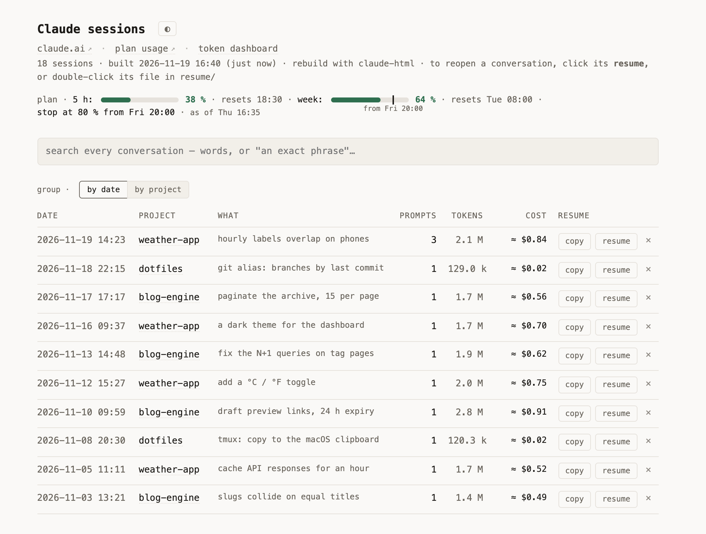
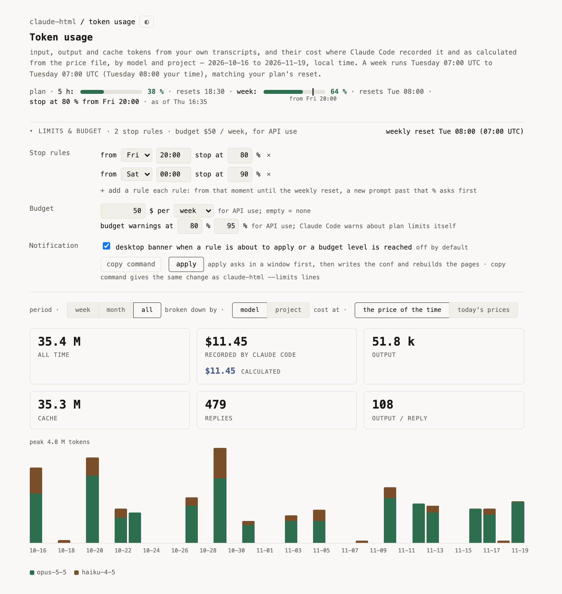
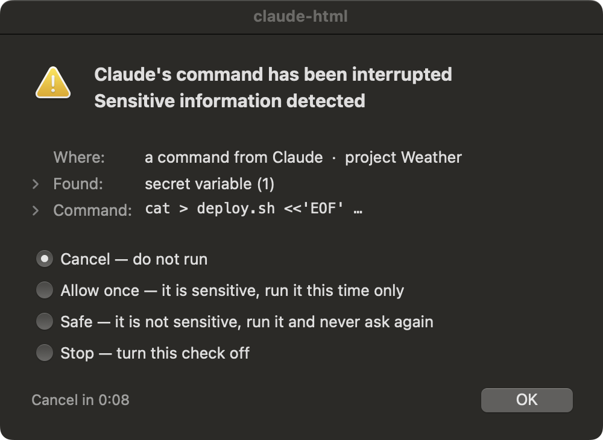

# claude-html

[](https://github.com/pier0074/claude-html/actions/workflows/test.yml)


[](LICENSE)
[](https://github.com/pier0074/claude-html/stargazers)

Every Claude Code conversation you have, kept forever and readable in your
browser: searchable, diffed, costed, and resumable with one click. One-line
install, nothing to add, and it builds itself while you work.

<picture>
  <source media="(prefers-color-scheme: dark)" srcset="docs/img/index-dark.png">
  
</picture>

<picture>
  <source media="(prefers-color-scheme: dark)" srcset="docs/img/session-dark.png">
  
</picture>

<picture>
  <source media="(prefers-color-scheme: dark)" srcset="docs/img/usage-dark.png">
  
</picture>

<picture>
  <source media="(prefers-color-scheme: dark)" srcset="docs/img/usage-project-dark.png">
  
</picture>



## Why

Claude Code deletes transcripts after 30 days, and raw JSONL is unreadable.
This keeps everything as plain HTML on your own disk: no server, no
database, no dependencies, and nothing of your conversations leaves your
machine.

- **Automatic and fast** — hooks save after every reply, at a session's end
  and before compaction, reading only what was appended. Saving even a 160 MB
  transcript takes seconds, and a page of fifteen thousand messages (16 MB)
  opens in half a second
- **Search** — full text across every conversation, straight to the message
- **Readable** — numbered prompts, labelled tool calls, real diffs; one click
  hides the machinery
- **Resumable** — **resume** reopens it in a terminal in the right folder;
  **copy** gives the `claude --resume` line
- **Permanent** — archives beside your projects, past the 30-day cleanup,
  thinking and token counts included
- **Dashboard and cost** — tokens by week, month or all time, by model or
  project; the recorded cost, and beside it the list-price cost from a
  dated price file
- **Private** — the pages make no requests; once a day the tool asks GitHub
  for its releases (`claude-html --update off` stops it). Light and dark
- **Secrets masked, and guarded** — tokens, keys and passwords become `***`
  in pages, search and archives; a prompt or command holding one is stopped
  before Claude sees it, and you choose what happens
- **Settings page** — every setting, its source and default, changed there
  or with `claude-html --config`
- **Plan limits and status line** — 5-hour and weekly usage on the status
  line and the pages, your own stop rules and an API budget; you choose what
  the status line shows, and it condenses to fit
- **Updates** — a daily look for a release, and, if you want, its install by
  itself (never a major one)

## Install

```bash
git clone https://github.com/pier0074/claude-html ~/claude-html
cd ~/claude-html && ./install.sh
```

For a given release, add `--branch v3.8.8` to the clone;
[CHANGELOG.md](CHANGELOG.md) says what each one brought.

A Mac needs nothing else (it uses `osascript`, or node if present). Linux
needs `node` 14.14 or later, from your distribution; `install.sh` and
`claude-html --doctor` say when it is missing.

**Where you clone it is the configuration:** the pages go in the clone, and
every session under its *parent* folder is archived (clone into
`~/Sites/claude-html` to cover `~/Sites`), or say so with
`./install.sh --out DIR --root DIR`. The installer only adds its own hooks
and keeps your `~/.claude/claude-html.conf`. Every setting is in
[docs/SETUP.md](docs/SETUP.md).

## Update

```bash
claude-html --update            # go to the newest release
claude-html --update 3.0.0      # go to that release
claude-html --update list       # every release available
claude-html --update status     # what is installed, what is newest
```

From a release before 3.1.0: `git checkout main && git pull && ./install.sh`.
Details in [docs/SETUP.md](docs/SETUP.md#updating).

## Use

Day to day, nothing: open `index.html`. The command is for the exceptions:

```bash
claude-html              # rebuild now and open the index
claude-html --force      # rebuild every page from scratch
claude-html --doctor     # what this machine is and which of its tools does each job
bash tests/run-all.sh    # every test suite, macOS and Linux
```

## Uninstall

```bash
cd ~/claude-html && ./install.sh --uninstall
```

Removes the command, the helper app or link handler and its hooks; keeps the
pages, archives and conf. Erasing every trace:
[docs/DETAILS.md](docs/DETAILS.md#uninstall).

## More

**[docs/SETUP.md](docs/SETUP.md)** — every setting, command and hook, with defaults.

**[docs/DETAILS.md](docs/DETAILS.md)** — how it works: saving, search, long
conversations, the dashboard, deleting, sub-agents, exports, Linux.

## License

MIT. Not affiliated with or endorsed by Anthropic; Claude is their trademark.
